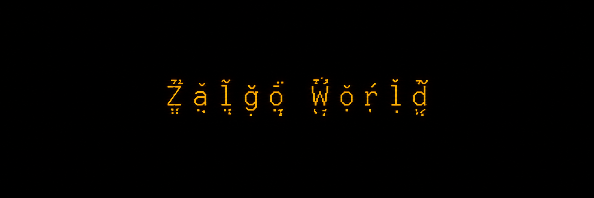

# Zalgo World

A cursed Hello World written in Malbolge. Self-modifying code prints UTF-8 Zalgo text, with a tiny Python interpreter and a reproducible generator.

```text
h̨͉͛̌e̝̙͐ľ̥̗l̩̈ǭ̭̅̈ ẉ̘͐̂͗o͍̔ŕ̡l̦̋d̘̱̏̆
```

## Run it

Requires Python 3.9 or later. No third-party packages are needed.

```sh
git clone https://github.com/zack-bolich/zalgo-world.git
cd zalgo-world
python run_malbolge.py
```

Use `python3` instead of `python` if that is how Python is installed on your system. You can also pass a source file explicitly:

```sh
python run_malbolge.py cursed_hello.mb
```

Use a UTF-8 terminal with a font that supports combining marks. The accents may look different across fonts and terminals. The program prints text only; the amber color is the banner's visual theme, not an escape sequence emitted by the program.

## How it works

`cursed_hello.mb` is the actual Malbolge program. The Python runner executes it through `mal.py` and writes the resulting bytes directly to standard output, preserving the UTF-8 combining marks.

`gen5.py` builds the output from lowercase `hello world`, using a fixed random seed of `666` to choose one to three marks above and one to two below each letter. It searches for Malbolge instruction sequences that emit each UTF-8 byte, then checks the finished program against the intended output.

The project is called **Zalgo World**; the program itself says **hello world**.

## Regenerate and verify

From the repository directory:

```sh
python gen5.py
python -m unittest discover -s tests -v
```

Regeneration overwrites `cursed_hello.mb` in the current directory. Progress goes to standard error and the verified Zalgo text goes to standard output. The tests compare the bundled program and command-line runner against the exact expected UTF-8 bytes.

## Files

| File | Purpose |
| --- | --- |
| `cursed_hello.mb` | Generated Malbolge program |
| `run_malbolge.py` | Command-line runner with raw byte output |
| `mal.py` | Minimal interpreter and instruction helpers |
| `gen5.py` | Deterministic Zalgo program generator |
| `tests/test_output.py` | Exact output and CLI checks |
| `assets/banner.png` | Amber Zalgo World banner and social preview artwork |

The bundled interpreter is intended for this demonstration. Input instructions are unsupported, and execution is capped at ten million steps.
